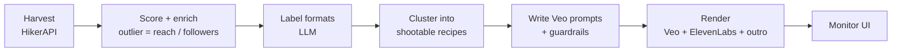

# Viral Ads Engine

Finds what is going viral on Indian Instagram, works out the repeatable format behind each hit, and writes and
renders AI video ads in that format. It refreshes every 3 hours across 11 languages.

**Product, pipeline design and prompts:** [Ankit Banerjee](https://www.linkedin.com/in/ankit-b-583768aa/)

## Why it exists

Consumer apps that run performance marketing need a steady flow of new ad concepts, and trends on Reels move
faster than a creative team can track. The engine looks for reels whose reach far exceeds their creator's
follower count: there the format, not the audience, carried the post, so the format is worth recreating.

## What it does

- **Harvest:** reels for 156 hashtag seeds across 3 genres and 11 languages via HikerAPI, with a 6-hour response cache.
- **Score:** velocity, reach, engagement and outlier ratio (reach ÷ followers), with an age penalty.
- **Understand:** an LLM (gpt-6-astra) labels each high-signal reel with its reproducible format, then the long tail is clustered into canonical, shootable recipes. A devotional layer also tags reels by audience archetype, angle, feature and emotion.
- **Write:** Veo 3.1 prompts balanced across trend, audience insight and competitor sources, using each app's positioning and hard guardrails; a checker flags any prompt that sneaks in an outro or CTA.
- **Render:** Veo 3.1 clips, optional ElevenLabs voice-over, and each app's outro appended and normalised to 1080×1920.
- **Operate:** one Render web service with a built-in scheduler every 3 hours; the monitor UI shows a rolling 3-day window by date, language and state.

## How it works



## Stack

Python · HikerAPI · Azure OpenAI (gpt-6-astra) · Veo 3.1 · ElevenLabs · ffmpeg · Docker on Render

## Pipeline

| Stage | Command | What it does |
|---|---|---|
| harvest | `python3 engine/harvest.py 45` | 156 hashtag seeds x 3 genres x 11 languages via HikerAPI -> scored reels |
| enrich | `python3 engine/enrich.py 300` | Looks up creator follower counts so `outlier = reach/followers` is real |
| trends | `python3 engine/trends.py 180` | gpt-6-astra labels each high-signal reel with its reproducible format |
| cluster | `python3 engine/cluster.py 14` | Collapses the label long-tail into canonical, shootable recipes |
| prompts | `python3 engine/prompts.py` | Writes Veo prompts, balanced across trend / insight / competitor |
| render | `python3 engine/render.py --limit 3` | Veo 3.1 -> optional ElevenLabs VO -> ffmpeg outro append |

Everything at once: `python3 run.py`  ·  Resume: `python3 run.py --from cluster`

## Monitor UI

```
python3 ui/server.py     # http://localhost:8765
```

Stdlib-only (no Flask/FastAPI) so it drops into any host. Tabs: trend timeline
(date x language x state), canonical formats, top reels, prompt library,
competitor teardown, renders, job logs. Buttons run each stage as a tracked
subprocess. "Upload outro" writes `data/assets/outro.mp4`.

When you move this to your backend, swap `BaseHTTPRequestHandler` for FastAPI routes —
the JSON shapes in `ui/server.py:state()` are already the API contract.

## The outro rule

No prompt ever contains an outro, end card, logo, app UI or CTA. Every Veo prompt ends
on the emotional beat. `engine/prompts.py` scans generated prompts for outro language and
flags `outro_clean: false` on any that slipped through. `engine/edit.py:attach_outro()`
concatenates your `data/assets/outro.mp4` after the body, normalising both to
1080x1920 / 30fps / 48kHz stereo first so the join is seamless.

## Scoring

`outlier = reach / followers` is the signal that matters. A 3,800-follower account doing
3.4M views means the FORMAT carried it, not the audience — that is what is worth
recreating. `score` combines log-velocity, log-reach, outlier and engagement rate, with an
age penalty.

## Config

- `config/taxonomy.yaml` — 11 languages -> states, 156 hashtag seeds, audience archetypes
- `config/apps.yaml` — positioning, differentiators and hard guardrails per app (the three apps here are fictional examples)
- `config/devotional_archetypes.yaml` — example archetype taxonomy for the devotional classifier
- `.env` — API keys (gitignored)

## Cost notes

One full harvest+enrich ≈ 485 HikerAPI calls. Veo 3.1 fast ≈ 130s per 8s clip.
The HikerAPI client disk-caches every response (6h TTL) so re-runs are close to free.
